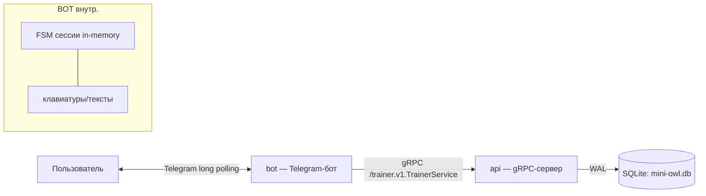
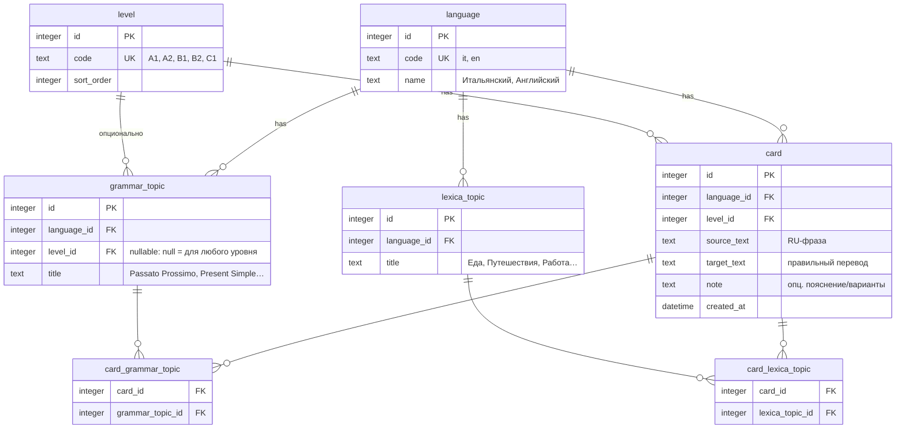
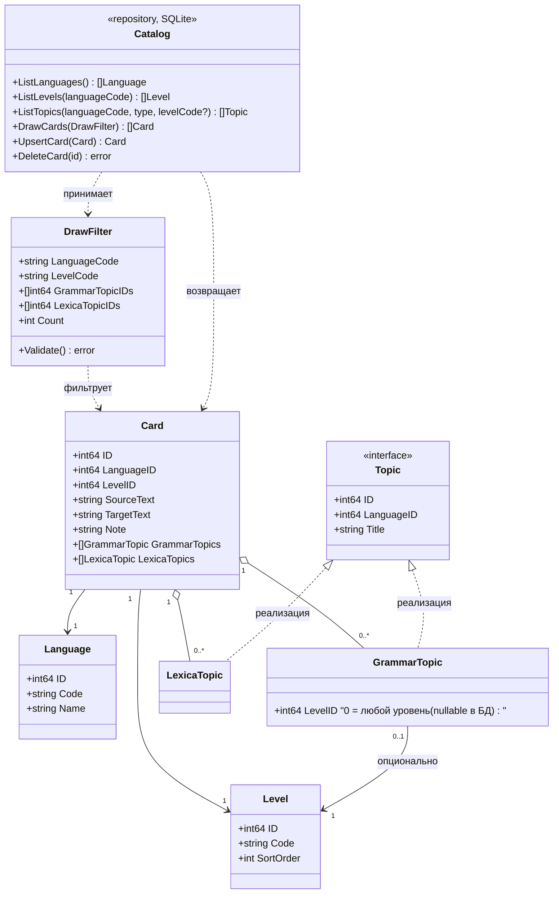
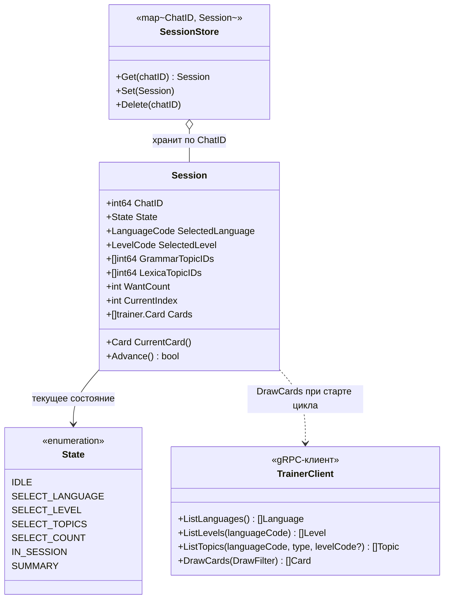
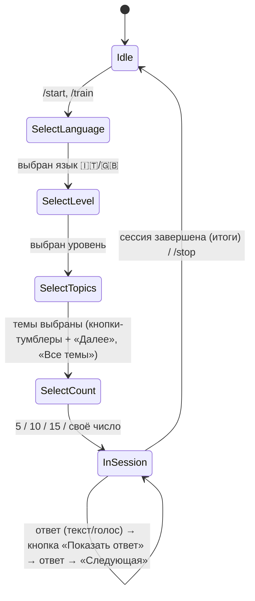
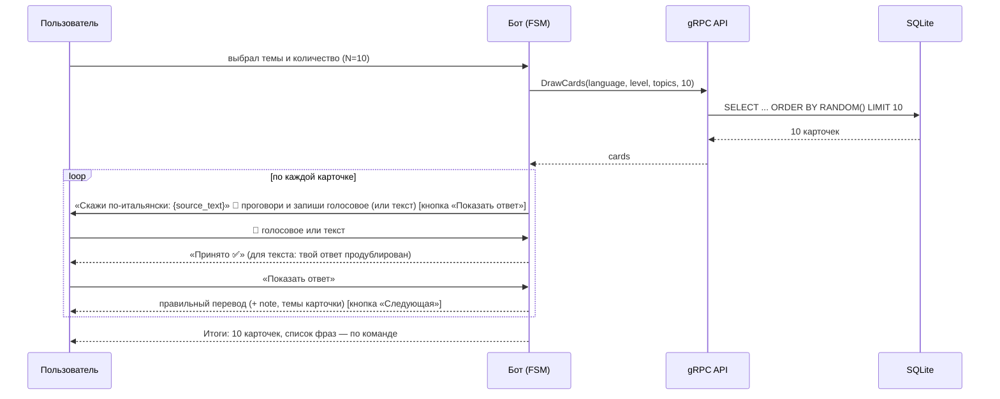

# План MVP: Telegram-бот-тренажёр перевода (mini-owl)

## Context

Приложение-тренажёр **спикинга**: пользователь получает русские фразы на выбранном целевом языке (стартово — итальянский и английский; родной язык всегда русский), проговаривает перевод вслух и записывает его голосовым (или текстом, если неудобно говорить), затем открывает правильный перевод и сравнивает со своим. Цель — практика устной речи. Отбор карточек — по уровню, грамматическим и лексическим темам, случайный без повторов в сессии, в заданном количестве за сессию.

Наполнение БД (генерация тем и карточек) — **отдельный скоуп**, в этот план не входит.

Вводные с решения пользователя:
- Языки: `it`, `en`; язык-источник — всегда русский.
- Стек: Go; API — **gRPC** (bot — отдельный gRPC-клиент).
- Голосовые: просто принять, без распознавания.
- Подбор: случайный без повторов, без SRS.
- Нагрузка: до 10 одновременных пользователей — SQLite, один процесс на каждый компонент.

Ключевой принцип: **API — универсальный сервис каталога карточек** (языки, уровни, темы, выдача случайных карточек), **бот — только UX/сценарии**. Никакой доменной логики в боте, кроме конечного автомата сессии.

---

## 1. Архитектура

Два Go-бинарника в одном модуле (monorepo), общая часть — proto-контракт и слой хранилища. Позже к gRPC API можно подключить web-клиент или второй бот без изменений.



- **Один SQLite-файл принадлежит только `api`** (и `seed` при наполнении). Бот полностью stateless: состояние сессии — в памяти процесса (10 пользователей → обычный `map[chatID]Session`).
- Бот через **long polling** (getUpdates) — не нужен TLS/webhook, идеально для MVP.
- SQLite в режиме WAL; конкурентная запись с одного процесса не проблема при такой нагрузке.
- Драйвер: `modernc.org/sqlite` (без CGO, простая сборка). Бот: `gopkg.in/telebot.v4`. Миграции: `goose` (embedded SQL).

### Структура репозитория

```
mini-owl/
├── proto/trainer/v1/trainer.proto
├── gen/trainer/v1/          # сгенерированный код (protoc + protoc-gen-go/-go-grpc)
├── cmd/
│   ├── api/                 # gRPC-сервер
│   └── bot/                 # Telegram-бот
├── internal/
│   ├── storage/             # sqlc/ручные репозитории поверх SQLite
│   ├── catalog/             # домен: карточки, темы, уровни + отбор
│   └── config/
├── migrations/
└── Makefile                 # protoc-генерация, миграции, seed, запуск
```

---

## 2. Доменные сущности

Ваша модель `card` скорректирована: поле `language` вынесено в FK (языков немного, но словарь удобен для UI бота), темы — связь M2M, а `level` — отдельная таблица-справочник.



Примечания:
- `grammar_topic` и `lexica_topic` привязаны к языку (Passato Prossimo не имеет смысла для английского). Лексические темы технически пересекаются между языками, но для MVP дублирование по языку проще.
- `grammar_topic.level_id` — **nullable**: `null` = тема подходит для любого уровня, иначе тема привязана к конкретному уровню (Passato Prossimo — A2/B1). В боте список грамматических тем на экране выбора фильтруется по выбранному уровню: `level_id = ? OR level_id IS NULL`.
- **Таблицы `user`/`session` в MVP нет**: API stateless, бот держит сессии в памяти. История ответов и статистика — в бэклоге (тогда добавятся `user`, `session`, `attempt`).
- Валидация «у карточки хотя бы одна тема» — на уровне приложения, не БД.

### Модели домена в коде

Доменные типы `internal/catalog` (API) и ботские структуры сессии — в виде class-диаграммы:



Ботский слой (`internal/bot/session` — in-memory FSM):



Пояснения к моделям:
- `Catalog` — единственная точка доступа к SQLite; домен не знает о gRPC и SQL-деталях (репозиторий в `internal/storage`, сборка запросов в `internal/catalog`).
- `DrawFilter` инкапсулирует фильтры и правила (count > 0, лимит 50, «пустые списки = любые») — один метод `Validate` на оба входа: gRPC-хендлер и будущий админ.
- `Session` — единственное mutable-состояние бота, живёт в `SessionStore` (map по chatID); после перезапуска бота сессии теряются (принято для MVP).
- `TrainerClient` — тонкая обёртка над сгенерированным gRPC-стабом, чтобы бот не зависел от proto-типов напрямую.

---

## 3. gRPC API (`proto/trainer/v1/trainer.proto`)

Универсальные сценарии: справочники для UI бота + выдача случайных карточек + (для наполнения) CRUD карточек.

```protobuf
syntax = "proto3";
package trainer.v1;

service TrainerService {
  // Справочники (для экранов выбора в боте)
  rpc ListLanguages(ListLanguagesRequest) returns (ListLanguagesResponse);
  rpc ListLevels(ListLevelsRequest) returns (ListLevelsResponse);       // опц. фильтр по language
  rpc ListTopics(ListTopicsRequest) returns (ListTopicsResponse);       // topic_type: GRAMMAR | LEXICA; для GRAMMAR опц. level_code (включая темы с level_id IS NULL)

  // Основной сценарий: N случайных карточек по фильтрам, без повторов
  rpc DrawCards(DrawCardsRequest) returns (DrawCardsResponse);

  // Наполнение — отдельный скоуп; RPC пригодятся будущему наполнителю/админу
  rpc UpsertCard(UpsertCardRequest) returns (UpsertCardResponse);
  rpc DeleteCard(DeleteCardRequest) returns (DeleteCardResponse);
}

message Card {
  int64 id = 1;
  string language_code = 2;
  string level_code = 3;
  string source_text = 4;            // RU
  string target_text = 5;            // перевод
  string note = 6;
  repeated Topic grammar_topics = 7;
  repeated Topic lexica_topics = 8;
}
message Topic { int64 id = 1; string title = 2; }
message TopicType { enum Enum { TOPIC_TYPE_UNSPECIFIED = 0; GRAMMAR = 1; LEXICA = 2; } }

message DrawCardsRequest {
  string language_code = 1;
  string level_code = 2;             // пусто = любой
  repeated int64 grammar_topic_ids = 3; // пусто = любые
  repeated int64 lexica_topic_ids = 4;  // пусто = любые
  int32 count = 5;                   // сервер ограничивает, напр. ≤ 50
}
// DrawCardsResponse { repeated Card cards = 1; int32 available = 2; }
// Семантика отбора: ORDER BY RANDOM() LIMIT count, DISTINCT по card.
// Если карточек меньше count — вернуть сколько есть + available, бот сообщит пользователю.
```

Реализация отбора в `internal/catalog`: один SQL-запрос с `JOIN` на темы (условия по каждой из M2M через `IN` + `HAVING COUNT(DISTINCT ...)` либо `EXISTS`), `ORDER BY RANDOM()` — при размерах MVP (сотни карточек) этого достаточно.

---

## 4. Telegram-бот

### Сценарий сессии (FSM в памяти бота)

Состояния: `Idle → SelectLanguage → SelectLevel → SelectTopics → SelectCount → InSession(card k/N) → Summary → Idle`.



### Ход карточки



Детали поведения:
- **Основной сценарий — говорение**: бот просит произнести перевод вслух и записать голосовое; текст — запасной вариант («не могу говорить сейчас»). Голосовые не распознаются и не сохраняются — бот лишь подтверждает получение и даёт кнопке «Показать ответ» появиться, пользователь сам сравнивает своё произношение с эталоном.
- **Ответ не оценивается автоматически** — пользователь сам решает, был ли перевод верным. Это осознанное упрощение MVP.
- Голосовое: бот отвечает «🎤 Принято! Нажми „Показать ответ“, чтобы свериться».
- Внутри карточки подряд разрешено несколько попыток (новое голосовое/текст) до нажатия «Показать ответ».
- Кнопки: выбор языка (2 кнопки), уровня (A1–C1), тем — inline-клавиатура с тумблерами ✅/⬜ и «Готово» (грамматические темы отфильтрованы по выбранному уровню: его темы + темы без уровня), количество — 5/10/15.
- Команды: `/start`, `/train` (новая сессия), `/stop` (прервать), `/help`.
- Повторный `/train` в середине сессии — перезапускает выбор (с подтверждением).
- Если DrawCards вернул 0 карточек — сообщение «Под этот фильтр нет карточек, выбери другие темы».
- Restart бота сбрасывает сессии (in-memory) — приемлемо для MVP; пользователь начинает заново командой `/train`.

---

## 5. Roadmap разработки

Этапы идут последовательно, каждый заканчивается проверяемым DoD. Этапы 0–1 — фундамент, 2–4 — API (заканчивается работающим e2e), 5–6 — бот, 7 — эксплуатация.

| Этап | Название | Результат | Зависит от |
|---|---|---|---|
| 0 | Скелет проекта | собирающиеся пустые бинарники | — |
| 1 | gRPC-контракт | сгенерированные стабы, контракт зафиксирован | 0 |
| 2 | Хранилище | схема БД + репозитории с тестами | 0 |
| 3 | Домен каталога | `Catalog` с отбором карточек, unit-тесты | 2 |
| 4 | gRPC-сервер | работающий api, smoke через grpcurl | 1, 3 |
| 5 | E2E API | 8 e2e-сценариев зелёные, CI-ready | 4 |
| 6 | Telegram-бот | полный сценарий сессии в Telegram | 1, 4 |
| 7 | Эксплуатация | docker-compose, README | 0–6 |

---

### Этап 0. Скелет проекта

**Задачи:**
- `go.mod` (модуль, go >= 1.22), `.gitignore` (`*.db`, `gen/`, `.idea/`)
- `Makefile` с целями-заглушками: `generate`, `migrate`, `api`, `bot`, `test`
- `internal/config`: чтение env (`DB_PATH`, `GRPC_ADDR`, `BOT_TOKEN`) + дефолты из секции 6
- `cmd/api/main.go`, `cmd/bot/main.go` — main с graceful shutdown (SIGINT/SIGTERM), slog-логгер

**DoD:** `make api` и `make bot` собираются и стартуют/останавливаются по Ctrl+C с вменяемым логом. Токен бота на этом этапе читается, но не используется.

---

### Этап 1. gRPC-контракт

**Задачи:**
- `proto/trainer/v1/trainer.proto` — полный контракт из секции 3 (сервис, `Card`, `Topic`, `TopicType`, `DrawCardsRequest/Response`, `UpsertCard/DeleteCard`)
- Инструменты генерации: buf (`buf.gen.yaml`) либо protoc + `protoc-gen-go`/`protoc-gen-go-grpc` — цель `make generate` → `gen/trainer/v1/`
- Зафиксировать поведение `count > 50` (решение из сценария 6 секции 7)

**DoD:** `make generate` воспроизводимо выдаёт стабы; `go build ./...` проходит; proto-файл закоммичен как источник правды.

---

### Этап 2. Хранилище

**Задачи:**
- Зависимости: `modernc.org/sqlite` (без CGO), `pressly/goose/v3` с embedded-миграциями
- `migrations/0001_init.sql`: таблицы `language`, `level`, `grammar_topic`, `lexica_topic`, `card`, `card_grammar_topic`, `card_lexica_topic`; справочные данные языков (it/en) и уровней (A1–C1) — INSERT в миграции; FK, уникальные индексы (`language.code`, `level.code`)
- `internal/storage`: `Open(path)` — прайгма: WAL, `foreign_keys=ON`, `busy_timeout`; goose-раннер миграций
- Репозитории: CRUD по каждой таблице, `UpsertCard` (транзакция: card + M2M), `DeleteCard`

**DoD:** `make migrate` применяет миграции на чистый файл; unit-тесты репозиториев на in-memory SQLite (включая upsert-обновление без дублей в M2M).

---

### Этап 3. Домен каталога

**Задачи:**
- `internal/catalog`: типы `Language`, `Level`, `Topic`/`GrammarTopic`/`LexicaTopic`, `Card`, `DrawFilter` + `Validate()` (count 1..50, непустой language_code)
- `Catalog.ListLanguages/ListLevels/ListTopics` (фильтр GRAMMAR по уровню: `level_id = ? OR level_id IS NULL`)
- `Catalog.DrawCards`: SQL-запрос с фильтрами по M2M (`EXISTS`/`IN` + группировка), `ORDER BY RANDOM() LIMIT count`, distinct, `available` (общее число подходящих)
- `Catalog.UpsertCard/DeleteCard` — делегирование в `internal/storage`

**DoD:** unit-тесты `DrawCards`: фильтры (грамматика/лексика/обе), distinct, недобор count, `available`, изоляция языков; тесты `Validate` на границы (0, 51).

---

### Этап 4. gRPC-сервер

**Задачи:**
- `internal/server`: реализация `trainer.v1.TrainerService` поверх `Catalog`; маппинг доменных ошибок в коды gRPC (`InvalidArgument`, `NotFound`)
- `cmd/api`: запуск сервера на `GRPC_ADDR`, подключение БД, миграции при старте, логи через slog
- Smoke-проверка руками: `grpcurl -plaintext` по всем RPC на БД с парой карточек, вставленных вручную (наполнение — отдельный скоуп)

**DoD:** `make api` поднимает сервер; все 6 RPC отвечают через grpcurl корректно, включая ошибки валидации.

---

### Этап 5. E2E-тесты API

**Задачи:**
- `internal/server/e2e_test.go`: хелпер `newTestClient(t)` — bufconn-сервер + gRPC-клиент + SQLite in-memory с миграциями
- 8 сценариев из секции 7: справочники, happy path, фильтры, пустая выдача, недобор, валидация, CRUD-цикл, изоляция языков
- Make-цель `test` прогоняет всё; проверить сборку без CGO

**DoD:** `make test` зелёный локально за секунды; фиктивных моков нет — путь клиент → gRPC → домен → SQLite протестирован целиком.

---

### Этап 6. Telegram-бот

Разбит на два подэтапа, чтобы клавиатуры и отладка UI не смешивались с логикой сессии.

**6a. Каркас + FSM выбора параметров**
- Зависимости: `gopkg.in/telebot.v4`; long polling, ленивое подключение к API с ретраями
- `internal/bot/session`: `Session`, `State`, `SessionStore` (map + mutex) — как в class-диаграмме секции 2; unit-тесты переходов FSM
- `internal/bot` хендлеры: команды `/start`, `/train` (с подтверждением перезапуска), `/stop`, `/help`; экраны выбора языка → уровня → тем (inline-тумблеры ✅/⬜, «Готово», «Все темы»; грамматика отфильтрована по уровню) → количества (5/10/15)
- Тонкий `TrainerClient` поверх gRPC-стаба

**DoD (6a):** в Telegram полный проход выбора до экрана количества; FSM-тесты зелёные; `/stop` и повторный `/train` не оставляют «зависших» состояний.

**6b. Цикл карточек и итоги**
- `DrawCards` после подтверждения количества; обработка пустой выдачи («нет карточек под фильтр»)
- Карточка: сообщение «Скажи по-итальянски: …» + кнопка «Показать ответ»; приём текста и голосового (только подтверждение «🎤 Принято»); несколько попыток до показа ответа; показ `target_text` + `note` + кнопка «Следующая»
- Итоги сессии; ограничение count (согласовано с сервером)

**DoD (6b):** полный e2e руками: сессия из 3 карточек (2 текстом, 1 голосом) от `/train` до итогов; прерывание `/stop` в середине.

---

### Этап 7. Эксплуатация

**Задачи:**
- `Dockerfile.api` / `Dockerfile.bot` (multi-stage, scratch/alpine, без CGO), `docker-compose.yml` из секции 6
- `README.md`: как запустить локально и в докере, где взять `BOT_TOKEN`, как прогнать тесты
- Команда бэкапа SQLite (`.backup`) — в README

**DoD:** `docker compose up` на чистой машине поднимает API и бота, сессия в Telegram проходит; README позволяет воспроизвести запуск с нуля.

### Осознанно за рамками MVP (бэклог)
Генерация тем и карточек (наполнение БД — отдельный скоуп), SRS/интервальные повторения, оценка ответов и STT (Whisper), сохранение/распознавание записанных голосовых, статистика и история (`user`, `session`, `attempt`), редактирование контента через админ-команды бота, webhook вместо polling.

---

## 6. Запуск и эксплуатация

### Конфигурация (env-переменные)

| Переменная | Компонент | По умолчанию | Описание |
|---|---|---|---|
| `DB_PATH` | api | `./mini-owl.db` | путь к файлу SQLite |
| `GRPC_ADDR` | api | `:50051` | адрес, который слушает gRPC-сервер |
| `BOT_TOKEN` | bot | — | токен бота от @BotFather (обязательная) |
| `GRPC_ADDR` | bot | `localhost:50051` | адрес gRPC API, к которому подключаться |

### Разработка

```bash
make generate   # protoc/buf → gen/trainer/v1
make migrate    # применить миграции к SQLite
make api        # терминал 1: gRPC API
make bot        # терминал 2: бот (BOT_TOKEN=123:ABC make bot)
make test       # unit + интеграционные тесты
```

Порядок важен: бот при старте устанавливает gRPC-соединение — API должен быть запущен раньше (или бот делает ленивое подключение с ретраями — выберем это, чтобы порядок запуска не был жёстким).

Токен бота хранится только в окружении — не в конфигах в репозитории (см. правило про секреты в git).

### Прод (VPS, до 10 пользователей)

Вариант A — **docker-compose** (рекомендуется: воспроизводимо и просто переносить):

```yaml
services:
  api:
    build: { dockerfile: Dockerfile.api }
    environment: [ DB_PATH=/data/mini-owl.db ]
    volumes: [ owl-data:/data ]
  bot:
    build: { dockerfile: Dockerfile.bot }
    environment: [ BOT_TOKEN=..., GRPC_ADDR=api:50051 ]
    depends_on: [ api ]
    restart: unless-stopped
volumes: { owl-data: }
```

Вариант B — **systemd**: по одному юниту `mini-owl-api.service` и `mini-owl-bot.service` с `Restart=on-failure`, логи в journald, SQLite-файл в `/var/lib/mini-owl/`.

Оба варианта работают через long polling — публичный IP/домен/TLS не нужны, достаточно исходящего интернета.

### Эксплуатационные заметки

- Бэкап: SQLite-файл копируется целиком (`sqlite3 mini-owl.db ".backup ..."` по cron или перед деплоем).
- Перезапуск бота сбрасывает in-memory сессии — пользователи начнут заново с `/train`; API можно перезапускать без влияния на бота (кроме обрыва текущих gRPC-вызовов, telebot-логика их переживёт).
- Логи: структурные (slog) в stdout — docker/systemd собирают их штатно.
- Мониторинг в MVP не делаем: `restart: unless-stopped` + логи достаточно. В бэклог — метрики.

---

## 7. E2E-тестирование API (основные пользовательские сценарии)

Цель — проверять API целиком так, как его видит бот: **реальный gRPC-сервер + реальный gRPC-клиент**, без моков домена. Это ловит ошибки контракта, SQL и валидации одновременно.

### Инфраструктура теста

- Расположение: `internal/server/e2e_test.go` (рядом с реализацией сервиса).
- Транспорт: `google.golang.org/grpc/test/bufconn` — gRPC-сервер и клиент в одном процессе через буфер, без портов (быстро, нет конфликтов).
- БД: SQLite in-memory (`file::memory:?cache=shared` на одно соединение) или temp-файл; миграции применяются тем же goose-раннером, что и в проде (embedded SQL) — схема в тестах идентична боевой.
- Фикстуры: справочники (`language`, `level`) приходят из миграций; карточки и темы создаёт сам тест через `UpsertCard` — заодно это тестирует CRUD. Регистрация клиента: один хелпер `newTestClient(t) (trainer.TrainerServiceClient, cleanup)`.

### Сценарии

Таблично-ориентированные тесты, один сценарий — одна под-тест-функция:

| # | Сценарий | Проверки |
|---|---|---|
| 1 | **Справочники** | `ListLanguages` → `it`, `en`; `ListLevels(it)` → A1–C1 по `sort_order`; `ListTopics(GRAMMAR, level=B1)` → темы B1 **плюс** темы с `level_id IS NULL`, но без тем A1; `ListTopics(LEXICA)` → все темы языка |
| 2 | **DrawCards happy path** | 20 карточек в БД, `count=10` → ровно 10 карточек, все ID различны (без повторов), все нужного языка |
| 3 | **Фильтры DrawCards** | по грамматической теме; по лексической; по обеим сразу — ни одна карточка вне фильтра не попала; темы из другого языка игнорируются |
| 4 | **Пустая выдача** | фильтр, под который нет карточек → `cards = []`, `available = 0` (валидный ответ, не ошибка) |
| 5 | **Недобор count** | карточек 3, `count=10` → 3 карточки, `available = 3` |
| 6 | **Валидация** | `language_code=""` → `InvalidArgument`; `count <= 0` → `InvalidArgument`; `count > 50` → сервер ограничивает (или `InvalidArgument` — решить при реализации, тест фиксирует поведение) |
| 7 | **CRUD-жизненный цикл** | `UpsertCard` → карточка сразу доступна в `DrawCards`; повторный `UpsertCard` с тем же `id` → обновление без дубля; `DeleteCard` → карточка исчезает из выдачи; удаление несуществующей → `NotFound` |
| 8 | **Изоляция языков** | заполнены `it` и `en`; `DrawCards(it)` не возвращает ни одной en-карточки и наоборот |

### Что осознанно не проверяем в e2e

- Случайность выборки статистически (рандом тестируем только на distinct/фильтры — детерминированно).
- Одновременные записи из нескольких горутин — SQLite+WAL под нагрузкой 10 пользователей; smoke-тест «10 параллельных DrawCards» опционально.
- Бота — его FSM покрывается отдельными unit-тестами `internal/bot/session` (переходы состояний, разбор колбэков), без сетевых вызовов.

### Запуск

```bash
make test         # весь юнит + e2e (секунды, bufconn + in-memory SQLite)
go test ./internal/server/ -run TestE2E -v   # только e2e
```

CI (GitLab CI): `go test ./...` на каждый MR — сборка без CGO (`modernc.org/sqlite`), никаких внешних сервисов не требуется.
